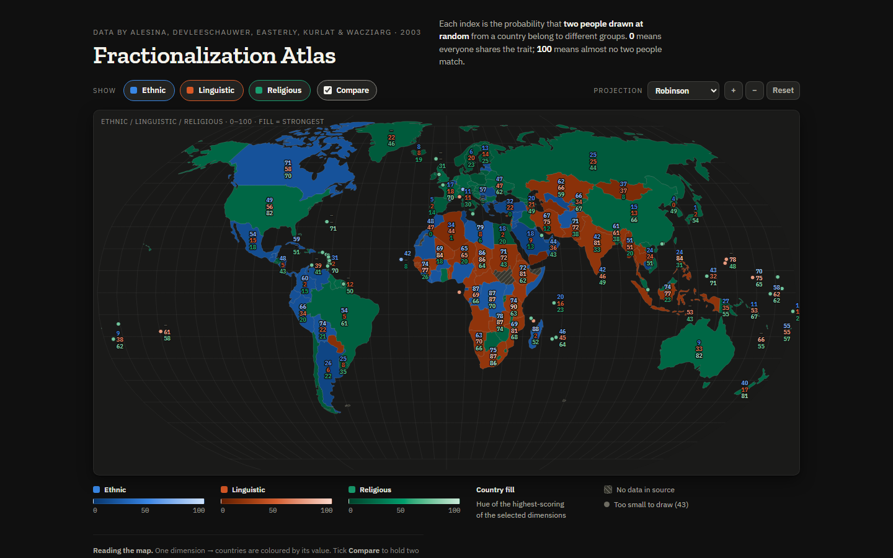

# No Two Alike

An interactive world map of **ethnic, linguistic and religious diversity** for 211 countries and territories.

**Live: <https://notwoalike.pages.dev>**

Each figure is the probability that two people drawn at random from a country belong to different groups, so "no two alike" is a plain restatement of the statistic. Switch on **Compare** to see two or all three types at once; each country is coloured by whichever is highest there.

## Data and credit

All figures come from Alesina, Devleeschauwer, Easterly, Kurlat and Wacziarg, *Fractionalization*, Journal of Economic Growth (2003), [NBER Working Paper 9411](https://www.nber.org/papers/w9411). The data reflects source material from roughly 1985-2001, not present-day conditions.

This is an independent visualisation, not affiliated with or endorsed by the authors, the NBER or the journal. Map geometry is from [Natural Earth](https://www.naturalearthdata.com/) via [world-atlas](https://github.com/topojson/world-atlas).

## Run it yourself

No build step and no backend. Open `site/index.html`, or serve the `site/` folder with any static host. D3 and the data are bundled, so nothing is requested from third parties.

Built with Claude Code.

## License

Code: MIT. The underlying data belongs to its authors; see the credit above.
